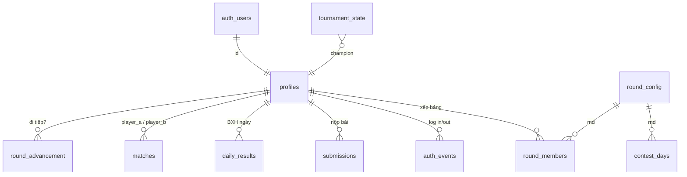

# Thiết kế database OTT (Supabase Postgres + file local)

## 1. Kiến trúc lưu trữ

| Loại dữ liệu | Nơi lưu | Lý do |
|---|---|---|
| Tài khoản, phiên đăng nhập | **Supabase Auth** | login/logout/refresh token có sẵn, JWT |
| Hồ sơ, vòng, bảng, điểm, BXH, metadata bài nộp | **Supabase Postgres** | nhẹ, cần truy vấn + RLS |
| Replay ván đấu (nước đi), code bot | **Ổ đĩa máy local** (`data/storage/`) | nặng; bot tuyệt đối không công khai |
| Working store khi chấm (`ott.db` SQLite) | local | chấm ghi hàng nghìn dòng/giây, giữ nguyên code cũ |

```
Trình duyệt ──JWT──► Cloudflare Tunnel ──► data/storage_server.py (local)
     │                                         │ hỏi quyền xem replay (RPC + JWT của user)
     └──────JWT──► Supabase (Auth + Postgres) ◄┘
                          ▲
 tournament.py (chấm) ──► data/sync.py  (upsert ott.db → Supabase, ghi replay ra file)
```

Quyền xem replay **không tự quản lý**: storage server chuyển JWT của người dùng sang hàm
`get_replay_ref(match_id)` của Supabase; hàm này chạy dưới RLS/`auth.uid()` nên chỉ trả kết quả
nếu người đó cùng bảng/vòng với trận và ngày đã chấm xong (hoặc là admin).

## 2. Sơ đồ quan hệ



## 3. Các bảng

| Bảng | Khóa | Nội dung |
|---|---|---|
| `profiles` | `id` (= `auth.users.id`), `lower(username)` unique | tên thi đấu, `role` (contestant/admin), `status` (new/active/out/banned), `entry_score`, `last_login_at`, `last_logout_at` |
| `auth_events` | `id` | nhật ký `register/login/login_failed/logout` + IP, user-agent |
| `tournament_state` | `id=1` (singleton) | `phase` (entry/round/done), `current_round`, `current_day`, `pending_day`, `accepting_submissions`, `champion_id` |
| `round_config` | `rnd` | số bảng, `top_n`, `wildcard_n`, số ngày, `min_days`, số trận/ngày, `is_offline` |
| `round_members` | `(rnd, user_id)` | **user ↔ vòng ↔ bảng**: `grp`, `seed` (thứ tự ban đầu) |
| `contest_days` | `(rnd, day)` | trạng thái ngày: open/closed/grading/graded |
| `submissions` | `(user_id, rnd, day)` | metadata nộp bài (giờ, sha256, kích thước). `rnd=0,day=0` = thi đầu vào. **Không chứa code** |
| `daily_results` | `(rnd, day, user_id)` | `pts`, `gs`, `rank`, `group_size`, `grp` — reset 0 mỗi ngày |
| `matches` | `id`, unique `(rnd,day,rd,a,b)` | trận BO2: `score_a` ∈ [-2,2], `has_replay` |
| `round_advancement` | `(rnd, user_id)` | `top` / `wildcard` / `eliminated` / `ineligible` + `avg_rank_pct` |
| `live_scores` | `(event, user_id)` | điểm chấm trực tiếp offline (vòng 5) |

Quy mô 4000 người: `round_members` ≤ ~4000 dòng/vòng; `daily_results` ≈ 4000 × 7 ngày × vòng 1 ≈ 28k;
`matches` ≈ 2000 × 7 trận × 7 ngày ÷ 2 ≈ 49k/vòng 1. Rất nhẹ cho Postgres (free tier đủ).

## 4. Ánh xạ luật thi → database

- **Chia bảng đầu vào**: `profiles.entry_score` + `round_members(rnd=1, grp, seed)`; `seed` là thứ hạng điểm (0 = mạnh nhất). Logic rải 1 người mỗi nhóm điểm vào mỗi bảng nằm ở `tournament.split_groups`.
- **Reset điểm mỗi ngày, xếp theo trung bình hạng**: `daily_results` có 1 dòng/ngày, thứ tự ban đầu ngày sau được tính từ `avg(rank)` của các ngày trước (`v_avg_rank`).
- **Điều kiện 4/6 ngày**: `v_submission_counts` (đếm `submissions` ngày < ngày cuối).
- **Vé vớt**: `round_advancement.avg_rank_pct = avg((rank-1)/group_size)`.
- **Không xem bài nhau**: `submissions` chỉ cho chủ sở hữu đọc; code bot nằm local, không có endpoint trả code.

## 5. Bảo mật (RLS)

- Mọi bảng bật RLS. Ghi dữ liệu thi đấu **chỉ bằng `service_role`** (máy chấm), không bao giờ đưa key này ra trình duyệt.
- Thí sinh chỉ đọc dòng của chính mình. BXH/trận của cả bảng đọc qua các hàm `security definer`:
  `get_group_leaderboard`, `get_group_matches`, `get_replay_ref` – tự khóa theo `auth.uid()`.
- `my_role()` / `is_admin()` cho admin xem toàn bộ qua client.
- Tắt "Allow new users to sign up" trong Supabase; tài khoản tạo qua backend (`data/manage.py`).

SQL đầy đủ: [`supabase/migrations/0001_schema.sql`](supabase/migrations/0001_schema.sql).
